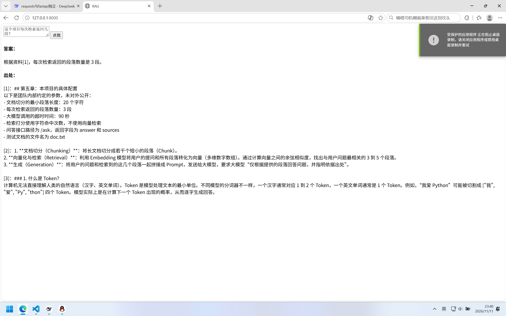

# RAG 文档问答

把一份文档放进去，用自然语言提问，得到答案和它的依据出处。

## 能做什么

- 上传/指定一份本地文档（`doc.txt`）
- 输入问题，返回答案 + 检索到的原文段落
- 资料里没有的内容，明确回答“资料中没有提到”，不编造

## 技术实现

一条完整的 RAG 链路，共四步：

1. **切分**：按空行拆段，再把不足 40 字的碎片并入下一段，避免标题单独成块
2. **检索**：对每段按关键词命中次数打分，取 top 3
3. **生成**：把 3 段资料编号后拼进 prompt，要求模型只依据资料回答
4. **溯源**：出处由检索结果直接返回，不依赖模型自己标注

## 已知局限

这一版是**有意简化**的版本，局限很清楚：

- **检索用字符匹配，不是向量检索。** 换个说法（比如“一次给模型几块材料”而不是“返回几段”）就可能检索不到——因为它只认字面，不认语义。
- 只有单一文档，检索范围是整个文件
- 没有对话历史，每次提问都是独立的
- 尚未部署，只能在本地运行

## 怎么跑

1. 安装依赖：`pip install -r requirements.txt`
2. 设置 key：`setx LLM_API_KEY "sk-你的key"`，**重开终端**
3. 启动：`uvicorn rag_api:app --reload`
4. 打开 http://127.0.0.1:8000

## 后续计划

- 用 Embedding + 向量检索替换关键词匹配（这是最该做的一步）
- 支持多文档与文档上传
- 加上对话历史，做成多轮问答